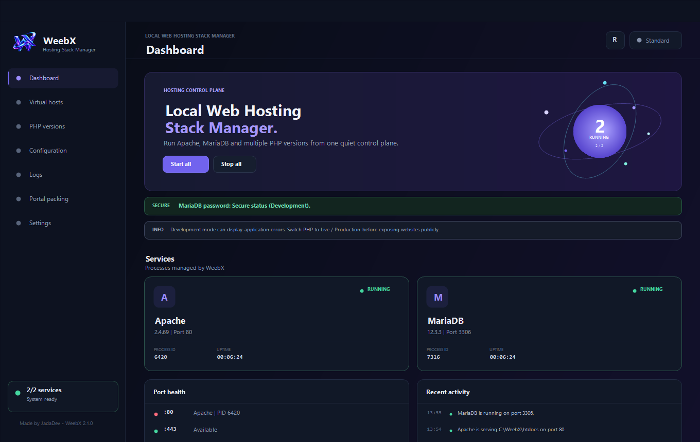

# WeebX

WeebX is a local Apache, PHP and MySQL (MariaDB) control panel for Windows. You install it, open it, start the stack, and work. Sites live in `htdocs`. phpMyAdmin is already there.

It is meant as a XAMPP alternative: same job (Apache + PHP + MySQL on your machine), but with a proper desktop app, several PHP versions side by side, and an installer that does not wipe your sites when you update.

Current release: **1.1.22**  
Site: [weebx.jadadev.com](https://weebx.jadadev.com/)

## Screenshot



## Video

[WeebX walkthrough](docs/walkthrough.mp4)

*Video will be available soon.*

## Stack

| Piece | Version |
| --- | --- |
| Apache | 2.4.69 |
| MariaDB (shown in the app as MySQL) | 12.3.3 |
| phpMyAdmin | 5.2.3 |
| PHP (x64 NTS, all bundled) | 8.2.35, 8.3.36, 8.4.27, 8.5.12 |

The runtime is copied into `%AppData%\weebx` on first launch. The installed `WeebX.exe` stays in Program Files. Updating the MSI is not supposed to delete MariaDB data or your websites.

Windows 10 / 11, x64. You will also need the usual Visual C++ x64 runtime that Apache and PHP already expect.

## What you can do

### Dashboard

- Start / stop Apache and MySQL, or start all / stop all
- See if they are actually running, including uptime
- Scan HTTP, HTTPS and MySQL ports and who owns them
- Open the local site and phpMyAdmin
- Recent activity from the stack

### Virtual hosts

- Create a site from a project name (that becomes the folder under `htdocs`)
- HTTP and HTTPS, with a self-signed cert from Apache's `openssl`
- Optional Windows hosts mapping (`127.0.0.1`) if you run WeebX as administrator
- Enable / disable a site without deleting the folder
- Help for pointing a real domain at a machine / VPS IP

Deleting a vhost in WeebX does not delete the files on disk.

### PHP versions

- Switch the PHP Apache is using (Apache restarts)
- Development vs production `php.ini` profile
- Enable / disable PHP extensions
- Enable / disable Apache modules
- Change the usual limits: post max size, upload size, memory, max execution time, max input time, max input vars, max file uploads
- **Save and restart Apache** after module or limit changes

### Configuration

Edit and save:

- `php.ini`
- `httpd.conf`
- `httpd-vhosts.conf`
- `my.ini`

Validate Apache / PHP / MariaDB config from the same screen. Saves keep a `.weebx.bak` next to the file.

### Logs

Apache, MySQL and WeebX messages in one list, with a filter.

### Portal packing

Pack the whole thing into a folder you can copy to another disk or PC:

- App + Apache + PHP + MariaDB
- Optional: include the database
- Optional: include `htdocs` (phpMyAdmin stays either way)

Unpack on the other machine and launch. WeebX rebases paths so Apache and MySQL still start. There is also `setup_weebx.bat` next to `WeebX.exe` for a portable `data` folder.

### Settings

- Runtime directory and document root
- Relocation repair if you copied or moved the folder (**Fix automatically** or pick the folder)
- HTTP / HTTPS / MySQL ports. MySQL has its own **Update** button: writes `my.ini` and restarts MySQL if it is running; if it is stopped it only changes the port
- MySQL root login (host `127.0.0.1` / `localhost`, user `root`)
- Change / force-reset the root password. If you forgot the old one, type a new one. If a password is set, an eye icon shows or hides it
- Start Apache and MySQL when WeebX opens
- Start WeebX with Windows
- Keep running in the tray
- Check port ownership before start
- Administrator vs standard (hosts file needs admin)

### Tray

- Open WeebX
- Start / stop Apache and MySQL
- Switch PHP version
- Uninstall
- Quit

### Uninstall

From the tray or from Apps. You type `UNINSTALL` to confirm. Apache and MySQL are stopped first. You can keep websites: they are copied to `Documents\WeebX Sites` (phpMyAdmin is skipped), then the program and AppData runtime are removed.

## Install

1. Run `WeebX-Installer-x64.msi`
2. Open WeebX
3. Wait for first-run copy of Apache / PHP / MariaDB (progress and time left are shown)
4. Start the stack

Default ports: HTTP 80, HTTPS 443, MySQL 3306. Root has no password until you set one.

## Build it yourself

Node.js 22+, Windows x64.

```powershell
npm install
npm run typecheck
npm test
npm run dev
```

Offline runtime + MSI:

```powershell
npm run prepare:runtime
npm run dist:msi
```

Installer ends up at `release\WeebX\WeebX-Installer-x64.msi`.

Runtime on disk looks like this:

```text
runtime/
├── apache/
├── certificates/
├── htdocs/
│   └── phpmyadmin/
├── mariadb/
│   └── data/
└── php/
    ├── 8.2.35/
    ├── 8.3.36/
    ├── 8.4.27/
    └── 8.5.12/
```

Binaries come from the usual places: [PHP for Windows](https://windows.php.net/), [Apache Lounge](https://www.apachelounge.com/download/), [MariaDB](https://mariadb.org/download/), [phpMyAdmin](https://www.phpmyadmin.net/downloads/).

This is a local development stack. Do not put it on the public internet.

## How this was built

WeebX is made by **JadaDev**.

The project was started with **Codex 5.6 Sol High**. The rest was built in **Cursor** with agents: **Claude** and **ChatGPT**. Most of the design came from Claude. Fixes, tests, and the long stretch of “this broke, fix it” also went through those agents, with JadaDev directing what the app should actually do.

Stack on the app side: Electron 45, electron-vite, React 19, TypeScript.

## License

MIT. See `LICENSE`.
